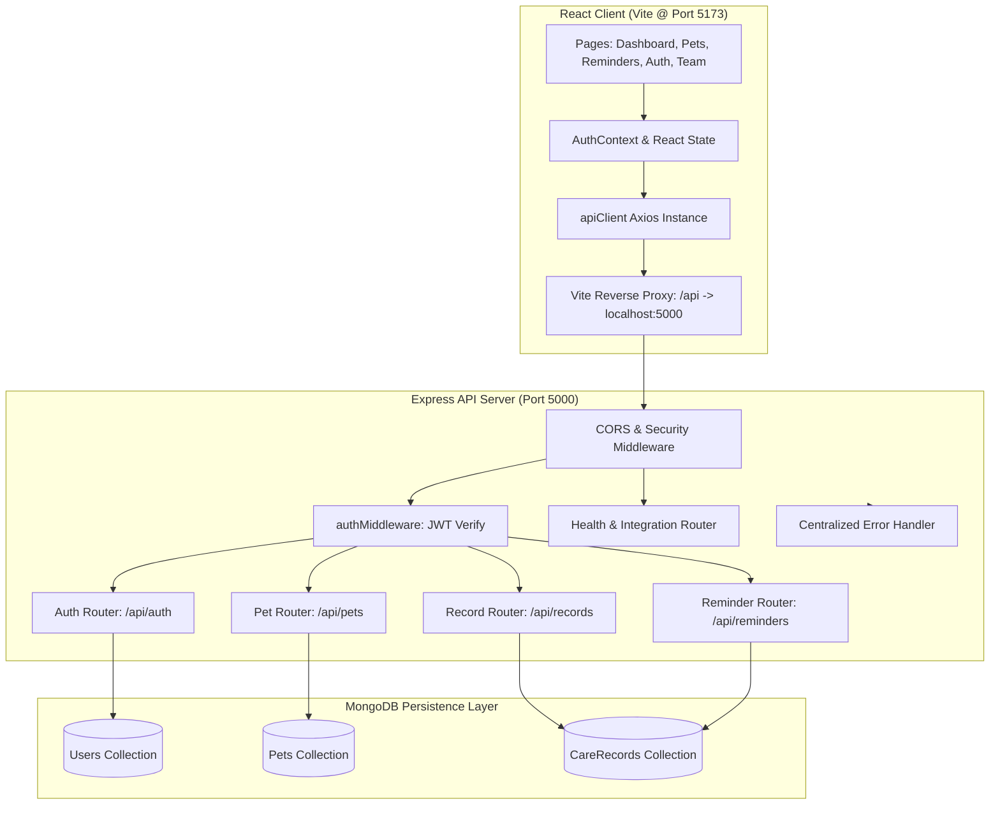

# 🏗️ PetCare Planner — System Architecture & Integration Guide

**Frontend & Backend Integration:** Godishala Kruthik Roshan (Roll: `2303A52339` · Branch: CSE AIML)  
**Team Name:** PawTech Innovators  
**Stack:** React 18, Node.js v24, Express.js 4, MongoDB (Mongoose 8)

---

## 1. High-Level System Architecture



---

## 2. Directory Structure

```text
petcare-planner/
├── package.json              # Orchestrates installation and scripts across client & server
├── .gitignore                # Production ignore patterns for node_modules, .env, build output
├── .env.example              # Master environment configuration template
├── README.md                 # Complete project guide, team matrix & submission checklist
├── docs/
│   ├── API_DOCUMENTATION.md  # Complete REST API reference with payload schemas
│   ├── ARCHITECTURE.md       # Architectural specifications & data flows
│   └── TASKS_ROADMAP.md      # Itemized status for Member 5 & remaining team tasks
├── server/
│   ├── package.json          # Express, Mongoose, JWT, bcryptjs dependencies
│   ├── .env.example          # Server environment template
│   ├── test-integration.js   # Automated integration handshake test
│   └── src/
│       ├── server.js         # Express app initialization, CORS, middleware, router mount
│       ├── config/
│       │   └── db.js         # Mongoose connection with error catching & auto-fallback
│       ├── middleware/
│       │   ├── authMiddleware.js # Bearer token parsing & authorization
│       │   └── errorHandler.js   # Standardized JSON error response handler
│       ├── models/
│       │   ├── User.js       # User Mongoose schema (Chippa Vasu)
│       │   ├── Pet.js        # Pet Mongoose schema (Bodasu Nithin)
│       │   └── CareRecord.js # CareRecord Mongoose schema (Bodasu Nithin)
│       ├── controllers/
│       │   ├── authController.js     # User registration, login, profile
│       │   ├── petController.js      # Pet profile CRUD
│       │   ├── recordController.js   # Care record CRUD & history
│       │   └── reminderController.js # Overdue/Upcoming date computation
│       └── routes/
│           ├── authRoutes.js
│           ├── petRoutes.js
│           ├── recordRoutes.js
│           └── reminderRoutes.js
└── client/
    ├── package.json          # React 18, React Router 6, Axios, Vite
    ├── vite.config.js        # Development server & proxy configuration (/api -> port 5000)
    ├── index.html            # HTML5 template with Plus Jakarta Sans typography
    ├── .env.example          # Client environment template (VITE_API_BASE_URL)
    └── src/
        ├── main.jsx          # React DOM entry
        ├── App.jsx           # App shell with navbar, footer & route routing
        ├── index.css         # Modern, responsive mobile-first stylesheet
        ├── api/
        │   ├── apiClient.js       # Centralized Axios client with JWT interceptor & health check
        │   ├── authService.js     # Auth API consumer
        │   ├── petService.js      # Pet profiles API consumer
        │   ├── recordService.js   # Care record API consumer
        │   └── reminderService.js # Reminders & timeline API consumer
        ├── context/
        │   └── AuthContext.jsx    # React Context for login/register/logout persistence
        ├── components/
        │   ├── Navbar.jsx         # Navigation bar with active route highlight & user dropdown
        │   ├── Footer.jsx         # Footer showing team attribution & stack
        │   └── ApiStatusBadge.jsx # Live visual indicator of backend connectivity
        └── pages/
            ├── Dashboard.jsx      # Metrics overview, quick actions, integration status card
            ├── PetProfiles.jsx    # Pet directory, creation modal, allergy tags
            ├── RemindersPage.jsx  # Care timeline, overdue tags, filter controls
            ├── LoginPage.jsx      # Authentication form with 1-click demo fill
            ├── RegisterPage.jsx   # New user registration form
            └── TeamPage.jsx       # Interactive PawTech team work distribution board
```

---

## 3. Frontend-Backend Integration Mechanism
1. **Network Bridge:** Vite development server proxies requests starting with `/api` directly to `http://localhost:5000` to eliminate CORS friction during development.
2. **Axios Central Client (`apiClient.js`):** Intercepts outgoing requests to attach `Authorization: Bearer <jwt_token>` from `localStorage`.
3. **Response Interception:** Automatically traps `401 Unauthorized` responses and cleans stale tokens while keeping user interface operational.
4. **Live Ping Badge:** `ApiStatusBadge.jsx` polls `/api/health` every 20 seconds to give real-time visual feedback on server availability.

